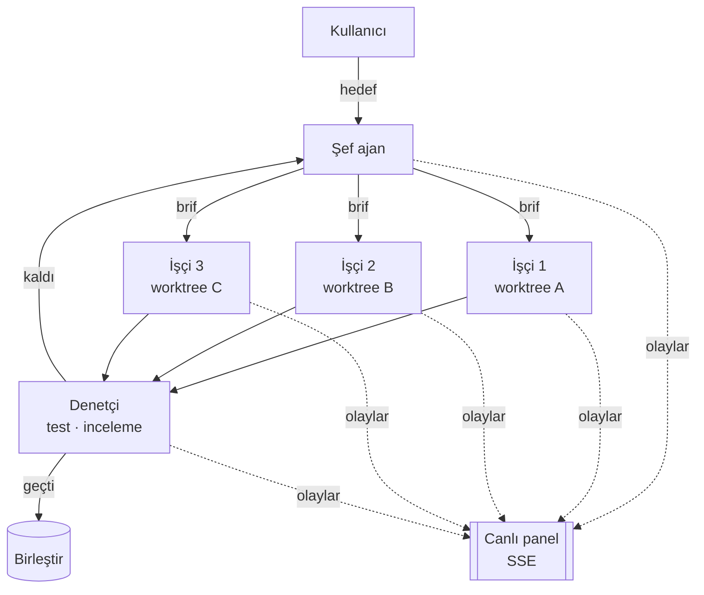

Zepul OS, birden çok Claude Code ajanını aynı kod tabanında çakıştırmadan çalıştırmak için yazdığım orkestra. Bir şef ajan işi brif adı verilen kısa sözleşmelere böler; işçi ajanlar kendi çalışma kopyalarında yazar; ayrı bir denetçi sonucu kontrol etmeden hiçbir şey birleşmez. Hepsi tarayıcıdaki canlı panelden izlenir.

## Özellikler

| | Ne yapar |
|---|---|
| 📋 **Brif şablonu** | Amaç, "bitti" tanımı, kapsam, kısıtlar ve bütçe; boş alanlı brif ajanı başlatmaz |
| 🔐 **Dosya sahipliği** | Her işçi yalnız kendi dosyalarına yazar; başka dosya gerekirse sahibine mesaj atar |
| 🌿 **Ayrı kopyalar** | Her iş kendi git worktree'sinde; ana dal temiz kalır |
| 🕵️ **Bağımsız denetçi** | İşi yapan ajandan ayrı bir oturum kabul ölçütlerini doğrular |
| 📡 **Canlı panel** | Ajanların metinleri, araç çağrıları ve sonuçları SSE akışıyla anlık görünür |
| 🛡️ **Güvenli varsayılanlar** | Panel yalnız `127.0.0.1` ve token ile; ajan ortamından sır adlı değişkenler süzülür; komutlar kabuksuz çalışır |

## Nasıl çalışır



Her ajan turu ayrı bir `claude -p --output-format stream-json` sürecidir; çıktı satır satır olaya çevrilir, panele ve olay günlüğüne düşer. Oturum kesilirse `--resume` ile kaldığı yerden sürer.

## Kurulum

```bash
npm install
npm run baslat       # orkestra sunucusu + panel
npm test             # testler
npm run denetim      # tip denetimi + testler
```

Gereken: Node.js, oturum açılmış Claude Code CLI.

## Teknoloji

TypeScript · Node.js · Claude Agent SDK · Claude Code CLI · Server-Sent Events · git worktree · zod
